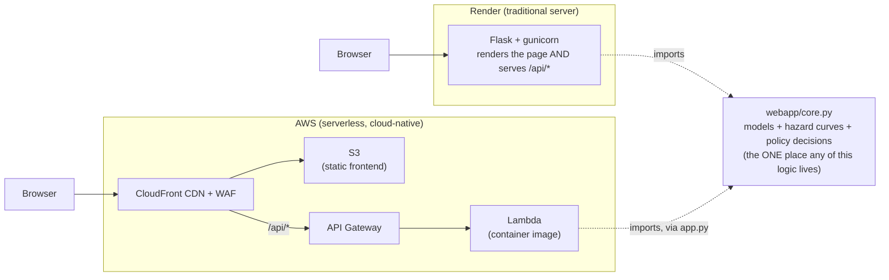

# A Workload-Aware, Cost-Sensitive Mitigation Policy for Cloud VM Failures

[](https://github.com/Rag2102/ccproject/actions/workflows/ci.yml)
[](https://github.com/Rag2102/ccproject/actions/workflows/ci.yml?query=branch%3Av2-research)


Production systems such as Narya, NENYA and Deoxys learn which failure mitigation to take, on private data. This project asks the question they leave open: **when does workload-aware ranking of VMs pay off at all?** It answers on public data, in simulation, with a pre-registered protocol. It has two parts: the v2 research described first, and the earlier v1 course project and its live demo below.

## v2 research (`v2-research` branch)

**Status, 19 Nov 2026:** all runs in the frozen matrix and the post-freeze tests are complete. Results are **preliminary** because Gate G3 is not signed ([`G3_decision.md`](docs/v2/G3_decision.md)). The research paper is being written in the Springer Nature template ([`paper-springer/`](paper-springer/)); it has not been submitted. Nothing here was run on a live cloud: regimes B1 and B2 are simulations calibrated from public traces.

| Claim | Result | Status |
| --- | --- | --- |
| Critical work is essentially uncorrelated with machine risk | \|τ-b\| ≤ 0.075 in three Google 2019 cells, under every mapping and proxy tested; the risk proxy is long machine removals | Measured, G1 signed off |
| Cost spread, not a break-even correlation, drives the gain from ranking | Closed form matches Monte Carlo at 3,024 of 3,024 points; in the simulator it gets the direction right and under-predicts the level | Theory checked |
| An open, rerunnable benchmark | 528 cells, 19,140 runs, none missing; scenario cards, hashed worlds, paired seeds | Built; no release tag or DOI yet |
| A tuned threshold can do worse than never migrating | P2 at a 2% budget in B1: −273% [−277, −268]; it beat never migrating in no seed | Preliminary |
| Placement can matter more than migration | On fresh seeds at 2% in B1, against never migrating: avoidance alone +11.2% [10.3, 12.1], P5 +8.1% [6.9, 9.0], BAM +3.7% [2.8, 4.4]; weakens to +3.8% with noisy predictions (σ = 1, redrawn daily) | Confirmed under a rule written first ([ADR-011](docs/v2/DECISIONS/ADR-011-avoidance-confirmation.md)); post-freeze, oracle predictor |
| BAM's saving against never migrating depends on migration cost | B1 at 2%: −17.4% [−18.5, −16.1] at the cheap end of the published cost range, +4.0% at the assumed cost, +1.0% [+0.3, +1.7] at the expensive end; BAM still beats P2 across the range | Exploratory ([ADR-009](docs/v2/DECISIONS/ADR-009-strengthening-experiment.md), [`RESULTS_COSTRANGE.md`](docs/v2/RESULTS_COSTRANGE.md)); 4 of 6 cost sources |
| Avoidance follows a simple law, S = φ R(q, σ) | Spearman 0.98 (B1) and 0.97 (B2) on 19 out-of-sample cells; φ is fitted, so a regularity, not a derivation | Supported under [ADR-012](docs/v2/DECISIONS/ADR-012-avoidance-concentration-law.md), frozen by hash |
| Two new policies | BAM that charges destination risk: B1 cheap migration −17.1% → +8.1% [7.3, 8.8], 16 of 16 tests, still −18.4% at σ = 1. Closing risky hosts per tier: rejected VMs 280 → 66 a run with saving +16.9% → +17.5% [16.7, 18.1], 8 of 8 tests | Confirmed under [ADR-013](docs/v2/DECISIONS/ADR-013-selective-avoidance-and-net-bam.md), frozen by hash; [`RESULTS_SELECTIVE_NET.md`](docs/v2/RESULTS_SELECTIVE_NET.md) |

All 30 pre-registered comparisons beat P2 at 50 seeds, and the fresh-seed replication agrees, 30 of 30. That is a low bar, because P2 is worse than doing nothing, so read the comparison against never migrating. The budget-aware rule itself is not new (Dantzig plus Elkan), BAM's gain comes from declining bad moves rather than from ranking, since the budget rarely binds, and the guard P6 fails as specified. The main matrix uses an oracle predictor, so its gains are an upper bound, and migration costs are assumed.

**Start here:** [`NOVELTY.md`](docs/v2/NOVELTY.md) (comparison with the base papers), [`PROTOCOL.md`](docs/v2/PROTOCOL.md), [`THEORY.md`](docs/v2/THEORY.md), [`CHANGES_AFTER_FREEZE.md`](docs/v2/CHANGES_AFTER_FREEZE.md) and [`ARTIFACT.md`](ARTIFACT.md) (hardware, times and expected outputs).

```bash
make reproduce-small
```

```bash
make stats
```

```bash
make console
```

These run a small end-to-end reproduction, rebuild the statistics from the committed cells, and build the read-only results viewer (`console/index.html`).

### Research paper

The paper is in [`paper-springer/`](paper-springer/), on the Springer Nature LaTeX template (December 2024 package). Its tables come from `results/summary` (`scripts/v2/56_paper_tables_postfreeze.py` and `scripts/v2/28_table3.py`), its numbers from `paper/numbers.tex` and its figures from `results/figures`. Build it with:

```bash
make paper-springer
```

This needs [Tectonic](https://tectonic-typesetting.github.io) (`brew install tectonic`) or a TeX distribution with `latexmk`. [`paper-springer/README.md`](paper-springer/README.md) has the submission checklist. The earlier ACM-format draft in [`paper/`](paper/) is superseded.

## v1: the course project

> **Read with care.** v2 re-examined this result and diagnosed v1's small loss at a matched budget as an accounting artifact ([`v1_anomaly.md`](docs/v2/v1_anomaly.md)). The "ρ ≳ 0.3" break-even below is not supported by v2, which finds that cost spread drives the gain. v1's description of a threshold as what Narya improves on is also not supported: Narya's baseline was a fixed action plan. v1 is kept as a record, frozen at tag `v1.0-course`.

v1 tested whether a cost-sensitive VM mitigation policy — one that weighs failure probability, estimated time-to-failure, workload criticality, and migration cost — reduces customer-impacting VM failures and unnecessary migrations better than a plain probability-threshold policy.

**v1's reported result:** under random workload placement the two policies come out roughly matched (the threshold slightly ahead at a fair, matched migration budget); the cost-sensitive policy's advantage emerges once workload criticality correlates with hardware risk (rank-correlation ρ ≳ 0.3), reaching +3.4% lower realized cost at ρ=0.9. Full writeup: [`docs/VM_Mitigation_Policy_Report.docx`](docs/VM_Mitigation_Policy_Report.docx).

## See it working: the live demo

```
pip install -r requirements.txt
cd webapp
python3 app.py
# open http://127.0.0.1:5000
```

A small Flask app: pick a real drive model, an age, a workload criticality, and a VM size, and it runs one of the
two trained failure-probability models **live** (your choice of the calibrated HistGBM from task 3, or the
from-scratch NumPy attention model from task 11), builds a survival curve, derives time-to-failure, prices a
real migration via the Clark et al. pre-copy formula, and shows what the cost-sensitive policy and the
threshold baseline each decide on those exact inputs -- side by side. It also displays the project's actual
validated headline results (the matched-budget comparison and the correlation-sweep chart) so the real
experimental findings are visible alongside the interactive part. This is genuine model inference each time you
click "run," not a lookup into a precomputed table.

Two notes on infrastructure-simulation tools, since this is exactly the kind of project people reach for
CloudSim or VMware to demo: neither is a fit here. CloudSim/SimGrid simulate datacenter *scheduling and
resource contention*; VMware is virtualization *infrastructure*. This project's actual deliverable is a
*decision policy* over three learned/derived signals (p_fail, TTF, cost) -- a lightweight web app that runs the
real trained models and the real decision functions demonstrates that far more directly than provisioning
either kind of heavyweight tool would. This mirrors `docs/project_scope.md`'s original reasoning for using a
purpose-built replay simulator instead of CloudSim/SimGrid for the *evaluation* itself (task 8) -- the same
"wrong tool for this job" reasoning applies even more strongly to a demo.

## A second deployment: real cloud architecture on AWS

The Render deployment above is one traditional server. `cloud/` holds a
second, more substantial deployment built specifically to demonstrate
cloud-native architecture: a static frontend on S3 + CloudFront, a
serverless JSON API on API Gateway + Lambda (container images, since
pandas/scikit-learn make zip-based Lambda painful), and -- the most
interesting piece -- the correlation-sweep experiment (task 9) reworked
from a single-seed local for-loop into 55 real, independent Lambda
invocations fanned out by a Step Functions Map state and combined by an
aggregator Lambda into a proper mean +/- std per correlation value.



Both deployments share the exact same prediction logic (`webapp/core.py`)
-- see `docs/cloud_architecture.md` for the full design and a more
detailed diagram of the AWS side, `docs/openapi.yaml` for the API
contract both expose, and `cloud/README.md` for the exact `terraform
apply` / `docker build` / `aws stepfunctions start-execution` commands to
deploy the AWS side into your own account.

## Repository layout

```
vmsim/      v2: simulator, policies P0-P8, theory
vmmbench/   v2: result and scenario-card schemas, validator
scripts/v2/ v2: every step from raw data to the paper's numbers, in numbered order
configs/v2/ v2: the frozen matrix and scenario cards
results/    v2: cell results, summaries, figures
paper-springer/ v2: the research paper (Springer Nature template); tables generated from results/
paper/      v2: earlier ACM-format draft, superseded; numbers.tex holds the generated number macros
console/    v2: static, read-only results viewer
docs/v2/    v2: protocol, theory, gates, decisions, log
reading/    v2: notes on the papers read
v1_reference/ v1: read-only frozen copy
scripts/    v1: pipeline, run in order (01 → 08); policy.py and build_report.js are imported/used by later steps
webapp/     v1: the live demo (Flask) -- see "See it working" above
models/     v1: saved, ready-to-use models the webapp loads directly (no retraining needed to run the demo)
docs/       v1: per-stage write-ups (task*_summary.md), project_scope.md, the final report, and figures/
data/raw/       Original downloaded datasets, untouched
data/processed/ Every intermediate and final output the v1 scripts produce
```

## Reproducing the pipeline

```
pip install -r requirements.txt
cd scripts
python3 01_preprocess.py                          # clean both raw datasets
python3 02_failure_probability_model.py            # discrete-time hazard model
python3 03_time_to_failure.py                      # TTF derived from the hazard curve
python3 04_workload_criticality_cost.py            # criticality tiers + migration cost model
python3 05_policy_design.py                        # the two policies + pre-simulation checks
python3 06_simulation_evaluation.py                # the replay simulator (naive + matched-budget comparison)
python3 07_correlated_assignment_experiment.py     # the resolving correlation-sweep experiment
python3 08_gqat_net_model.py                       # task 11: from-scratch NumPy attention model vs. HistGBM
```

`08_gqat_net_model.py` also runs `test_gqat_numpy_gradcheck.py`'s logic implicitly correct (that script itself
is a standalone verification step -- run `python3 test_gqat_numpy_gradcheck.py` on its own to re-verify the
hand-derived backward pass against numerical finite differences before trusting a training run). Both scripts
depend on `numpy_nn.py` and `gqat_net_numpy.py`, which have no other dependencies beyond `numpy`/`scipy`/
`scikit-learn` -- see `docs/task11_summary.md` for why (TensorFlow/PyTorch/Keras/JAX are all unavailable in the
sandbox this project was built in; this was confirmed, not assumed, before writing a from-scratch NumPy
neural network as the alternative).

Each script reads from `data/processed/` and/or `data/raw/`, and (over)writes its own outputs there — running them in order regenerates everything in this repo from the two raw datasets, including the large Azure VM tables (see below on why those are still committed directly rather than left to regeneration only).

To rebuild the Word report (`docs/VM_Mitigation_Policy_Report.docx`) from `docs/figures/` and the numbers in `scripts/build_report.js`:

```
cd scripts
npm install docx
node build_report.js
```

## Data sources and licensing

This project combines two real, independently-sourced datasets — no public dataset links real VM placement to real host failures (that internal linkage is what makes Microsoft's Narya possible inside Azure), so two real datasets stand in for the two sides of that picture:

- **`data/raw/azure/`** — the Azure Public Dataset V1 VM trace, Microsoft's own release, downloaded directly from its GitHub release (`github.com/Azure/AzurePublicDataset`, released under **CC BY 4.0** — attribution required, freely reusable). 2,013,767 real VMs over a 30-day trace.
- **`data/raw/backblaze/`** — a real per-drive survival summary (122,618 drives, 6,912 real failures, 2013–2017) derived directly from Backblaze's own published daily SMART/failure telemetry (`backblaze.com/cloud-storage/resources/hard-drive-test-data`, which Backblaze explicitly makes free to use). The specific summarized CSV bundled here was built by a third party, [vfonov/hdd_survival_backblaze](https://github.com/vfonov/hdd_survival_backblaze) — **that specific repository carries no explicit license file**, so if you plan to redistribute this repo further or make it public long-term, consider regenerating an equivalent summary directly from Backblaze's own raw quarterly files instead (the derivation method is documented in that repo's `import.sh`, and is straightforward: one row per drive with real failure/censored status and real age at that outcome). Included here with attribution for a research/coursework context.

### Getting the large Azure files

Three files exceed GitHub's 100MB per-file limit, so they are **not included** in this bundle as delivered: `data/raw/azure/vmtable.csv.gz` (~156MB, the original Azure release asset) and its two derivatives, `data/processed/azure_vms_clean.csv.gz` (~154MB, task 2's output) and `data/processed/azure_vms_with_costs.csv.gz` (~198MB, task 5's final per-VM output). Only the first is an actual external dependency — the other two are fully regenerated by this repo's own scripts:

```
mkdir -p data/raw/azure
curl -L -o data/raw/azure/vmtable.csv.gz \
  https://github.com/Azure/AzurePublicDataset/releases/download/dataset-v1/trace_data_vmtable_vmtable.csv.gz

cd scripts
python3 01_preprocess.py                  # regenerates data/processed/azure_vms_clean.csv.gz
python3 04_workload_criticality_cost.py   # regenerates data/processed/azure_vms_with_costs.csv.gz
```

That URL is Microsoft's own GitHub release asset for the Azure Public Dataset V1 (CC BY 4.0) — the same file this project used throughout, unmodified. The two `python3` commands take under a minute combined and reproduce the exact processed files this project used (they also regenerate `data/processed/backblaze_drives_clean.csv` and the Backblaze summary tables from the small raw file that *is* included, so running the full pipeline from `01` through `07` reproduces everything in `data/processed/` from just the two raw sources).

`setup_and_push.sh` runs both of the steps above automatically before pushing. `.gitattributes` already routes all 3 of these files through **Git LFS** once they exist locally, so once fetched/regenerated, a plain `git add .` / `git commit` / `git push` handles them correctly — no manual `git lfs track` step needed.

Everything else in this repo — every other real dataset, every intermediate table, every script, every report — is included directly; Git LFS is only needed for these 3 files.

## Getting the code

The repository is [`github.com/Rag2102/ccproject`](https://github.com/Rag2102/ccproject). The v2 research and the paper are on the `v2-research` branch; `main` holds v1.

```bash
git clone https://github.com/Rag2102/ccproject.git
```

```bash
cd ccproject && git checkout v2-research
```

Three large v1 files are stored with Git LFS (see "Data sources and licensing"); `git lfs pull` fetches them. Everything else, including the live demo, works without them.

## v1 key findings, at a glance

These are v1's findings as reported at the time; see the note at the top of the v1 section. See `docs/task*_summary.md` for full detail on each stage. In order:

1. **Data** (`data_summary.md`) — real datasets combined; drive model, not age, dominates real failure risk (one Seagate batch fails at 36% vs 3–8% for others — the real, publicly-known bad batch).
2. **Failure probability** (`task3_summary.md`) — discrete-time hazard model, ROC-AUC 0.781, properly calibrated (a first attempt using class-balancing was caught and corrected because it would have silently broken the downstream cost math).
3. **Time-to-failure** (`task4_summary.md`) — derived from the same hazard curve; concordance index 0.71 against real outcomes.
4. **Criticality & cost** (`task5_summary.md`) — migration cost grounded in the classic live-migration pre-copy formula (Clark et al., NSDI 2005), using real VM memory/vCPU/CPU-utilization data.
5. **Policy design** (`task6_7_summary.md`) — the cost-sensitive decision rule and its threshold baseline, validated on hand-built scenarios and a full real-data decision surface.
6. **Simulation** (`task8_summary.md`) — the honest result: a naive comparison favored cost-sensitivity, but the fair (matched-budget) comparison didn't confirm it, and diagnosed why (random VM-to-host assignment removes any signal for cost-awareness to exploit).
7. **Resolving experiment** (`task9_summary.md`) — sweeping the correlation between workload criticality and host risk recovers the hypothesized advantage once ρ ≳ 0.3, with a clean monotonic curve.
8. **GQAT-Net comparison** (`task11_summary.md`) — a from-scratch NumPy re-implementation of a real published attention-based failure model (Tripathi et al. 2025), gradient-checked and trained on the same data/split as the HistGBM model; the calibrated tree model still wins on every metric, especially calibration (Brier 0.002 vs. 0.067) — reinforcing task 3's central lesson that calibration, not architecture sophistication, is what makes a probability usable inside a cost formula.
