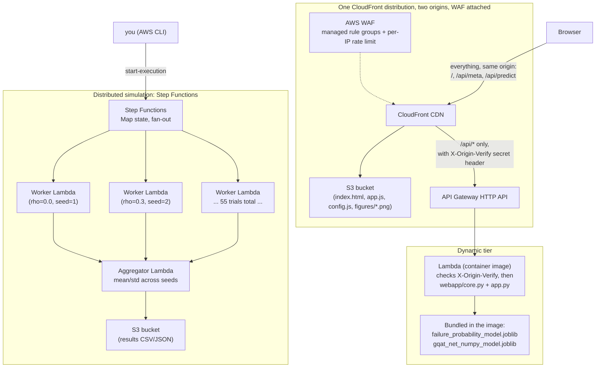

# Cloud architecture (AWS)

This project has two live deployments, deliberately different in kind:

1. **Render** (see the root `README.md`) -- one traditional server (Flask +
   gunicorn) running the whole app. Simple, fast to set up, good enough for
   "here's a link, click it."
2. **AWS** (this document; deployment steps in `cloud/README.md`) -- a
   decoupled, serverless, cloud-native architecture built specifically to
   demonstrate real cloud-computing patterns: a CDN-served static frontend,
   an autoscaling stateless API, and a genuinely distributed simulation.
   Both deployments run the *exact same, shared* prediction logic
   (`webapp/core.py`) -- see below for why that matters.

## Why split the app instead of just "Flask on Lambda"

The quickest way to move a Flask app to Lambda is to wrap the whole thing
(HTML rendering included) behind one Lambda + API Gateway pair -- a
"lift and shift." That works, but it means every request, including a
request for a static PNG chart that never changes, spins up a Lambda
invocation. This project instead splits along the natural cloud-native
seam:

- **Static tier** (HTML/CSS/JS/PNG) -> S3 + CloudFront. Cacheable at the
  edge, scales to arbitrary traffic for pennies, and never touches compute.
- **Dynamic tier** (the actual model inference) -> API Gateway + Lambda.
  Stateless, autoscaling, pay-per-invocation, and the only part of the
  request path that ever needs to run Python.

This is the standard "JAMstack meets serverless API" pattern, and it's a
better answer to "show me cloud architecture" than a single server,
however that server is hosted.

Both tiers sit behind the *same* CloudFront distribution and the *same*
WAF web ACL now (`cloud/infra/waf.tf`, `cloud/infra/s3_frontend.tf`) --
not because API Gateway HTTP APIs support that natively (they don't: no
usage plans, no API keys, no WAF -- those are REST-API-only features), but
because putting CloudFront in front of the API is what makes protecting it
with WAF possible at all. A shared secret CloudFront injects as a request
header (`X-Origin-Verify`) and the Lambda checks before doing anything
else is what stops the raw API Gateway URL from being called directly,
bypassing CloudFront and WAF both. See `cloud/infra/waf.tf`'s comment for
the full reasoning, including why an API key wouldn't have added real
security here anyway (it would have had to live in public browser JS).

## One source of truth, two deployments

`webapp/core.py` holds every piece of actual logic: loading the models,
building hazard curves, computing migration cost, calling the two
policies. Neither deployment target contains its own copy:

- `webapp/app.py` (Render/local) is a ~50-line Flask wrapper around
  `core.py`.
- `cloud/api/lambda_function.py` (AWS) is a ~50-line WSGI adapter that
  hands API Gateway's event straight to the *same* `app.py`/`core.py`.

So there is no risk of the two deployments silently drifting apart -- the
project already applies this principle to the two mitigation policies
(`scripts/policy.py`, imported everywhere rather than reimplemented); this
extends it to the deployment layer too.

The WSGI adapter is hand-written (not `aws-wsgi`/`mangum`/
`serverless-wsgi`) deliberately: API Gateway HTTP API's payload format 2.0
event is simple enough that a ~50-line adapter is fully readable in one
sitting, which is one less black-box dependency between "what we tested"
and "what's deployed." It was verified locally against a synthetic
API Gateway event before ever touching real AWS -- see
`cloud/api/lambda_function.py`'s docstring and the commit history.

## Why a container image, not a zip, for Lambda

`pandas`, `scikit-learn`, and `scipy` are exactly the packages that make
zip-based Lambda painful: manylinux wheel cross-compilation, the 250MB
unzipped / 50MB direct-upload size limits, and binary-compatibility
mismatches if you build on the wrong platform. A container image (up to
10GB, built with the official `public.ecr.aws/lambda/python:3.11` base)
sidesteps all of it, and is the currently recommended AWS pattern for any
data-science-heavy Lambda function.

## The distributed simulation: from a for-loop to real fan-out

`scripts/07_correlated_assignment_experiment.py` swept 4 hardcoded rho
values (each with exactly one random seed) in a local Python for-loop --
fine for a first pass, but with no way to tell a real effect from a single
lucky/unlucky seed, and no reason it *has* to run sequentially: each
(rho, seed) pair is a fully independent trial.

`cloud/sim/sim_core.py` extracts that per-trial logic unchanged (verified
line-for-line to reproduce script 07's own saved output --
`data/processed/correlated_assignment_sweep.csv` -- exactly, at all 4 of
its original rho values, before trusting the new sweep). A Step Functions
**Map state** then fans this out over 55 trials (11 rho values x 5 seeds --
see `cloud/sim/trials.json`), running up to 10 concurrently, each as its
own Lambda invocation. An aggregator Lambda combines all 55 results into a
mean +/- std per rho value and writes it to S3.

This is a genuine improvement, not just an infrastructure exercise: the
original experiment couldn't distinguish signal from single-seed noise;
the distributed version can (and running it as 55 sequential local trials
instead would just be slower for no benefit -- the whole point of the
fan-out is that independent trials cost the same wall-clock time whether
there are 4 of them or 400).

## What's deliberately NOT in this design

- **No custom domain / ACM certificate** -- CloudFront's default
  `*.cloudfront.net` domain is used as-is. Adding a Route53 zone + ACM cert
  is a small addition if you own a domain, but isn't needed to demonstrate
  the architecture.
- **No VPC** -- none of these Lambdas talk to a database or anything else
  that would need one; adding a VPC here would only add a NAT gateway bill
  and cold-start latency for no benefit.
- **No autoscaling configuration to write** -- this is the actual point of
  serverless: Lambda and CloudFront scale automatically, so there is no
  autoscaling group, launch template, or scaling policy to author. Where a
  traditional EC2-based architecture would need one, "there's nothing to
  configure" *is* the architectural answer.
- **CORS is scoped to the CloudFront domain, and now mostly moot** --
  `cloud/infra/api_gateway.tf` locks `allow_origins` to the live
  CloudFront domain (not `*`), but since the frontend now calls `/api/*`
  on that same CloudFront distribution (see above), those are same-origin
  requests that never trigger a CORS preflight in the first place. The
  API Gateway CORS config is kept only as a safety net for direct calls
  to the raw invoke URL during local debugging.
- **No custom domain means no per-client API keys, and that's fine** --
  even on a REST API (where API Gateway usage plans/keys are actually
  supported), an API key handed to an anonymous public browser demo would
  have to live in public JS, which defeats what a "key" is for. The WAF
  rate-based rule (`cloud/infra/waf.tf`) protects this deployment against
  the thing that actually matters for a public demo -- request floods from
  a given source -- without pretending an unauthenticated demo has
  individually-identifiable clients to issue keys to.
